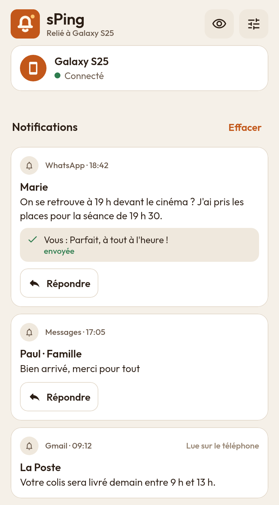
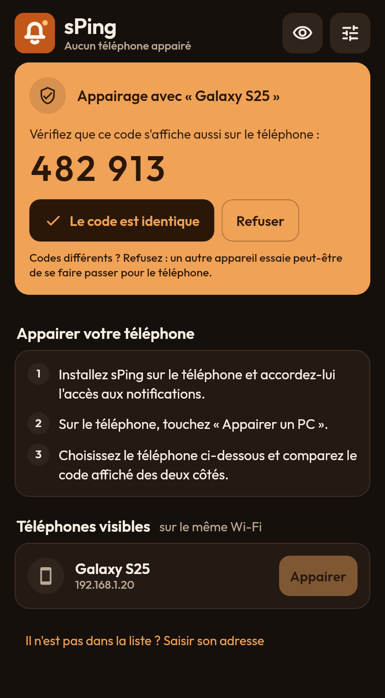
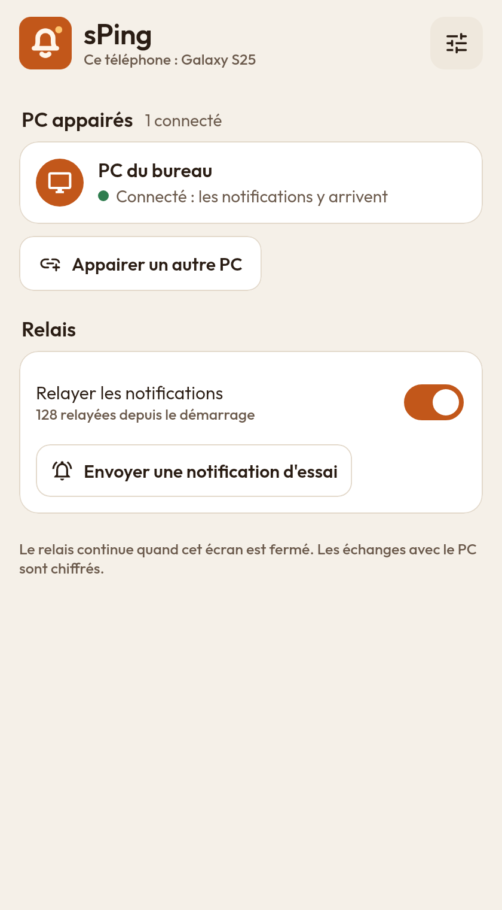
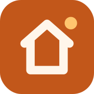

<h1 align="center">sPing</h1>

<b>Les notifications du téléphone, en direct sur le PC. Et vous répondez sans le sortir de votre poche.</b>

  
  
  

Un SMS, un message WhatsApp, un rappel de rendez-vous : avec sPing, il s'affiche aussitôt
sur l'écran de votre PC, dans une notification Windows et dans la fenêtre de sPing. Vous
lisez sans quitter ce que vous faites, et vous répondez au clavier. Le téléphone reste
dans la poche, au fond du sac ou en charge dans l'entrée.

  
  
  

## Pourquoi sPing

- **Vous ne ratez plus rien.** Concentré sur l'écran du PC, vous voyez passer chaque
  notification du téléphone au moment où elle arrive.
- **Répondre devient plus rapide que de chercher son téléphone.** Un vrai clavier, une
  réponse envoyée en quelques secondes, depuis la notification Windows elle-même.
- **Vos messages restent les vôtres.** Tout est chiffré de bout en bout entre vos deux
  appareils, sur votre Wi-Fi. Pas de compte, pas de serveur, rien ne passe par Internet.

## Ce que fait sPing

### 🔔 Chaque notification, en direct
Messages, rappels, colis, e-mails : dès qu'une notification arrive sur le téléphone, elle
s'affiche sur le PC, en notification Windows et dans la fenêtre de sPing, avec
l'application, l'expéditeur, le texte et l'heure. À la connexion, celles qui sont déjà sur
le téléphone vous attendent aussi.

### ↩️ Répondre depuis le PC
SMS, WhatsApp, Messenger… : quand une notification propose une réponse rapide
sur le téléphone, vous pouvez répondre depuis le PC. Écrivez directement dans la
notification Windows ou dans la fenêtre de sPing, et la réponse part du téléphone comme si
vous l'aviez tapée dessus. sPing vous confirme qu'elle est envoyée.

### 🙈 Mode discret
L'écran est partagé, vous présentez quelque chose ? Un clic sur l'œil, et sPing n'affiche
plus que « Nouveau message de Marie », jamais le contenu, ni dans les notifications
Windows ni dans la fenêtre.

### 🔐 Appairé une fois, chiffré toujours
Vous appairez le téléphone et le PC une seule fois, en vérifiant qu'un même code à six
chiffres s'affiche des deux côtés. Ensuite, tout est chiffré, et aucun autre appareil ne
peut ni lire vos notifications ni répondre à votre place.

### 🌙 Toujours là, jamais encombrant
Sur le téléphone, le relais tourne en arrière-plan, même écran de sPing fermé. Sur le PC,
sPing se range dans la zone de notification près de l'horloge, et peut démarrer avec
Windows. La fenêtre étroite se cale sur le côté de l'écran.

### 🌗 Clair ou sombre
Un thème clair et un thème sombre, au choix ou selon le système.

## Prise en main

1. **Installez** sPing sur le téléphone et sur le PC avec les boutons en haut de cette page.
2. **Sur le téléphone**, ouvrez sPing et accordez-lui l'accès aux notifications (l'appli
   ouvre le bon réglage).
3. **Appairez** : sur le téléphone, touchez « Appairer un PC » ; sur le PC, choisissez le
   téléphone, vérifiez que le code est le même des deux côtés et acceptez. C'est fait.

Le [guide d'utilisation](docs/GUIDE.md) détaille l'installation, les réglages de batterie de
Samsung, le pare-feu Windows et les solutions aux soucis courants.

## Questions fréquentes

**Faut-il un compte ou un abonnement ?** Non. sPing est gratuit, sans compte, sans
publicité.

**Mes messages passent-ils par Internet ?** Non. Ils vont directement du téléphone au PC,
sur le Wi-Fi de la maison, chiffrés. Aucun serveur, aucun nuage.

**Quelqu'un d'autre sur le Wi-Fi peut-il les lire ?** Non. Les échanges sont chiffrés
(AES-256-GCM) avec des clés qui n'existent que sur vos deux appareils. Un appareil non
appairé ne reçoit rien et ne peut rien envoyer, même s'il emprunte le nom de votre PC.

**Avec quels appareils ?** Un téléphone Android 11 ou plus récent, et un PC sous Windows.
sPing a été pensé autour d'un Samsung Galaxy S25.

**Puis-je répondre à toutes les notifications ?** À celles qui proposent une réponse
rapide sur le téléphone (la plupart des messageries). Pour les autres, sPing les affiche
seulement.

**Et si je suis hors de la maison ?** sPing fonctionne quand le téléphone et le PC sont sur
le même réseau. Hors de portée, il attend, et reprend tout seul au retour.

## La famille sPack

sPing fait partie de **sPack**, une famille d'applications pratiques pour la maison, toutes
dans le même style.

| | | | |
| :---: | :---: | :---: | :---: |
|  |  |  |  |
| **[sDash](https://github.com/ShinezeoGame/sDash)** Toute la maison sur une tablette | **[sPhone](https://github.com/ShinezeoGame/sPhone)** L'écran du téléphone sur le PC | **[sDrop](https://github.com/ShinezeoGame/sDrop)** Fichiers et textes entre téléphone et PC | **sPing** Les notifications du téléphone sur le PC |

---

Fonctionnement, sécurité, développement et logo : voir [docs/DEVELOPPEMENT.md](docs/DEVELOPPEMENT.md).
Police [Outfit](https://github.com/Outfitio/Outfit-Fonts) sous licence SIL Open Font License 1.1.
